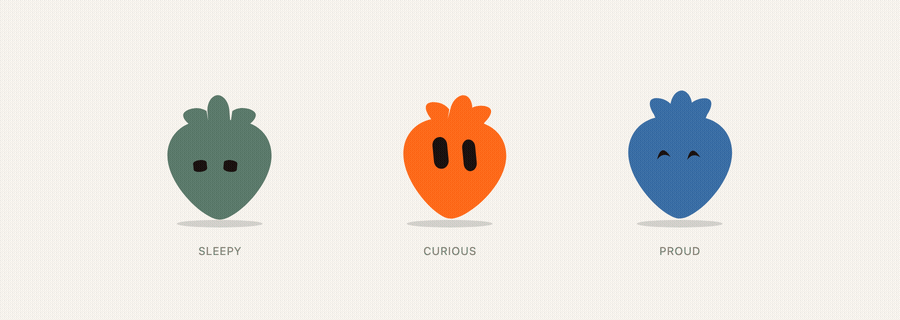

# procedural-bot-animations



A procedural animation engine for 2D SVG mascots and bot avatars. A character is a body outline, two eyes and up to three moving parts. The engine adds one pose per frame on top of that: an idle that never repeats, blended moods, looping activities, one-shot reactions, eyes that look, blink and react, and parts that sway and bend on springs. It renders plain DOM (one SVG, no framework). The part that computes the pose does not touch the DOM, so you can draw it yourself.

Characters and animations are plain JSON, so you can write them by hand or generate them with an LLM. The package also contains a typed state machine and a scroll traveler.

The cover image was made with an earlier version of the engine. It shows Berry, one of the two built-in characters.

## Install

```bash
npm install procedural-bot-animations
```

The package is ESM only, needs a DOM for `mountCharacter`, and has no runtime dependencies.

## Quick start

```ts
import { mountCharacter, RIG_BERRY } from "procedural-bot-animations";

const host = document.querySelector<HTMLElement>("#bot")!;

const bot = mountCharacter(host, {
  rig: RIG_BERRY,
  size: 200,
  color: "#e11d2e",
  label: "Berry, the assistant",
});

bot.update({ mood: "curious" }); // a held expression
bot.update({ mood: { curious: 0.6, focused: 0.4 }, activity: "thinking" }); // a blend, plus a loop
bot.react("success"); // a one-shot reaction
// bot.destroy(); // removes the SVG and the listeners
```

By default the character looks at the pointer, reacts when the pointer enters it or it is clicked, and follows `prefers-reduced-motion`. The built-in moods, activities and reactions are listed in [`skills/procedural-bot-animations/references/motion-cookbook.md`](skills/procedural-bot-animations/references/motion-cookbook.md) and exported as `MOODS`, `ACTIVITIES` and `REACTIONS`.

A minimal page is in [`examples/minimal.html`](examples/minimal.html).

## The Studio

The Studio is a static demo in [`site/`](site), served from GitHub Pages at <https://jp-mainieri.github.io/procedural-bot-animations/>. It shows a character on a stage, lets you import your own character and animation JSON, and has prompts you can copy into an LLM to generate them. [`examples/README.md`](examples/README.md) says how to run it locally.

## Bring your own character

A character is one JSON object in a 0..100 box. Its core keys (`version`, `id`, `name`, `body.path`, `eyes`) are an [Open Bot Avatar](https://github.com/dominikscholz/open-bot-avatar) definition, so any valid Open Bot Avatar definition is accepted unchanged. An optional `rig` key adds moving parts, eye styles, idle sway and flicker.

```ts
import { mountCharacter, parseCharacter } from "procedural-bot-animations";

const parsed = parseCharacter(jsonText); // never throws
if (!parsed.ok) throw new Error(parsed.errors.join("\n")); // every problem, each starting with its JSON path

mountCharacter(host, {
  rig: parsed.value.rig,
  color: parsed.value.definition.rig?.color, // the format's suggested colour; you pass it on yourself
});
```

The full contract, with every limit and a worked example, is in [`docs/character-format.md`](docs/character-format.md). `parseCharacter` runs `validateCharacter` and then `characterToRig`; both are exported too.

## Bring your own animations

An animation is one JSON object of kind `reaction` (plays once), `activity` (loops) or `mood` (a held pose). It is a set of keyframe tracks over named fields such as `bodySy`, `partL`, `lidTop` or `eyeX`. Every value is an offset from the resting pose.

```ts
import {
  RIG_BERRY,
  addToLibrary,
  createLibrary,
  mountCharacter,
  parseAnimation,
} from "procedural-bot-animations";

const library = createLibrary(); // a copy of the built-ins that is safe to extend

const result = parseAnimation(jsonText); // never throws
if (!result.ok) throw new Error(result.errors.join("\n"));
addToLibrary(library, result.value.compiled);

const bot = mountCharacter(host, { rig: RIG_BERRY, library });
// or, on a character that is already mounted: bot.update({ library });

const { kind, id } = result.value.definition;
if (kind === "reaction") bot.react(id);
if (kind === "activity") bot.update({ activity: id });
if (kind === "mood") bot.update({ mood: id });
```

The full contract, the field list with ranges and a house style for good motion are in [`docs/animation-format.md`](docs/animation-format.md). `describeAnimation(definition)` returns a one-paragraph summary of what an animation does.

## Generate them with an LLM

Both format documents end with a **Prompt** section: a self-contained block you copy into any LLM, followed by a description of what you want.

- Characters: [Prompt in `docs/character-format.md`](docs/character-format.md#prompt)
- Animations: [Prompt in `docs/animation-format.md`](docs/animation-format.md#prompt)

Paste the model's JSON into `parseCharacter` or `parseAnimation`. Each error starts with the JSON path of the problem, so you can paste the errors back to the model and ask for a fix. The Studio offers the same prompts. If you use Claude Code, the skill in [`skills/procedural-bot-animations/`](skills/procedural-bot-animations) teaches an agent to generate and self-check both formats.

## What's in this repo

| Path | What |
|---|---|
| [`src/mount.ts`](src/mount.ts), [`src/ticker.ts`](src/ticker.ts) | `mountCharacter`, the plain-DOM SVG renderer, and the shared `requestAnimationFrame` loop |
| [`src/brain.ts`](src/brain.ts) | `Brain`: computes one `Pose` per frame. No DOM |
| [`src/gaze.ts`](src/gaze.ts), [`src/focus.ts`](src/focus.ts) | Eye movement (saccade, pursuit, microsaccades, attention, boredom) and the gaze modes (`free`, `focus`, `data-bot-focus` anchors) |
| [`src/moods.ts`](src/moods.ts), [`src/reactions.ts`](src/reactions.ts), [`src/interactions.ts`](src/interactions.ts), [`src/transformations.ts`](src/transformations.ts) | 9 moods, 5 activities, 36 reactions, the hover and click gestures, and the body-to-object transformations |
| [`src/parts.ts`](src/parts.ts), [`src/motion.ts`](src/motion.ts), [`src/delta.ts`](src/delta.ts) | Part physics and path bending, springs, keyframe tracks, blink, jump, and the list of animatable fields |
| [`src/rig.ts`](src/rig.ts), [`src/characters/`](src/characters) | The `Rig` type, and the built-in characters Berry and Flame |
| [`src/character.ts`](src/character.ts), [`src/animation.ts`](src/animation.ts), [`src/library.ts`](src/library.ts), [`src/examples.ts`](src/examples.ts) | The two JSON formats (validate, compile, parse), the per-instance library, and original example characters and animations written as data |
| [`src/state-machine.ts`](src/state-machine.ts), [`src/scroll-traveler.ts`](src/scroll-traveler.ts) | A typed state machine and a scroll traveler. Both are DOM-free |
| [`docs/`](docs) | [`architecture.md`](docs/architecture.md), [`character-format.md`](docs/character-format.md), [`animation-format.md`](docs/animation-format.md) |
| [`skills/procedural-bot-animations/`](skills/procedural-bot-animations) | A [Claude Code](https://claude.com/claude-code) skill: mount a character, generate character and animation JSON, tune motion |
| [`site/`](site) | The Studio |
| [`examples/`](examples) | A minimal page |
| [`tests/`](tests) | Vitest tests. They run in Node, with no DOM |

## The eyes

The eyes are most of why a character feels alive. What the engine does, all of it in `src/gaze.ts`, `src/brain.ts` and `src/mount.ts`:

- **Saccades.** When the target jumps, the eye hops there on a slightly underdamped spring, aims a little short and settles. It does not glide in a straight line.
- **Pursuit.** When the target moves slowly, such as a cursor, the eye follows it smoothly. A fast cursor is followed firmly instead of with a chain of hops.
- **Microsaccades.** At rest, the eye makes tiny random shifts every 0.5 to 1.6 s, so it is never perfectly still.
- **Blinks.** A random interval of 1.8 to 6 s. One blink in five is a double blink. A large saccade can trigger a blink. There are no blinks while the character sleeps.
- **Attention and boredom.** Big saccades, a fast cursor and a close cursor raise attention: the eyes grow and the lids open. When nothing happens for a few seconds, boredom rises and the lids get heavy.
- **Shape follows movement.** During a fast saccade the eyes stretch along the movement and tilt toward it, then relax. Looking up enlarges the eye. Looking down lowers the eyelid.
- **Cross-eyed look.** With the cursor right on top of the character, the eyes move closer together.
- **Real eyelids.** The upper and lower lids are clip paths with an adjustable tilt, so a mood can frown or squint instead of only scaling the eye. A happy eye crossfades into an arc.
- **Fake 3D turn.** The `turn` field slides the eyes sideways and shrinks the far one. Past 1, the face turns to a profile where one eye vanishes.
- **Where to look.** `gaze: "pointer"` follows the cursor. `"free"` wanders across the page and gets drawn to page events. `"focus"` looks at what matters: focused fields, typing, clicks, scrolling and elements with `data-bot-focus`. You can also pass a point or a function.

The numbers are in [`skills/procedural-bot-animations/references/motion-cookbook.md`](skills/procedural-bot-animations/references/motion-cookbook.md). How the pieces connect is in [`docs/architecture.md`](docs/architecture.md).

## State machine and scroll traveler

`createStateMachine` is a small typed state machine with timed transitions (`after`), interrupt rules (`interruptibleBy`) and subscribers. It does not know about characters: you connect a state to `update({ mood, activity })` or `react(...)` yourself. Call `tick(dtMs)` every frame to advance the `after` timers. See [`skills/procedural-bot-animations/references/state-machine-guide.md`](skills/procedural-bot-animations/references/state-machine-guide.md).

`travelerFrame` and `findActiveSlot` compute where a character should be as the page scrolls between sections. They take numbers (slot rectangles that you read yourself) and return numbers.

## Accessibility

- **Reduced motion.** `reducedMotion` is `"auto"` by default and follows `prefers-reduced-motion`. You can force it with `true` or ignore it with `false`. When it applies, the character stops idling, jumping, squashing and blinking, and the idle sway of the parts stops. Reactions lose their movement fields (position, rotation, scale, turn, sparks, embers, smoke and transformations). The gaze follows its target with simple smoothing instead of saccades. Changes of expression (eyelids, eye shape, happy eyes, accessories such as `!` and `?`) still show.
- **Screen readers.** With the `label` option the SVG gets `role="img"` and `aria-label`. Without it the SVG is `aria-hidden="true"`.
- **Decorative mode.** `interactive: false` turns off hover and click reactions.
- The SVG has no tab stop and no keyboard handlers. If a click on the character does something in your app, give that action a real button.

## Relationship to Open Bot Avatar and DevBerry

**Open Bot Avatar.** This project is independent and unofficial. It is not affiliated with Open Bot Avatar or published by its author, Dominik Scholz. Open Bot Avatar is MIT-licensed. From it, this project uses only the shape of its JSON definition (`version`, `id`, `name`, `body.path`, `eyes`), and it adapts its path grammar. It has no runtime dependency on the `open-bot-avatar` package and never calls its renderer.

**DevBerry.** The engine is a TypeScript port of the mascot engine behind [DevBerry](https://devberry.app), made generic: the rig, the brain, the gaze, the moods, the reactions and the transformations come from there. Berry and the Flame are DevBerry's characters, included with the owner's permission.

## Migrating from 0.1

0.2.0 replaces the whole engine. It is a breaking change, with no compatibility layer.

0.1 was a small engine for one silhouette with two pill eyes. These 0.1 exports no longer exist:

| 0.1 export | Use instead |
|---|---|
| `bindBrain`, `BoundBot`, `BindOptions` | `mountCharacter(host, { rig })`, which returns `{ brain, svg, update, react, jump, currentReaction, getGazeState, destroy }` |
| `mountRig`, `MountedRig`, `RenderOptions`, `Bounds` | `mountCharacter` |
| `AvatarDefinitionLike` | `CharacterDefinition` and `parseCharacter(json)`, which also returns a `Rig`. Open Bot Avatar definitions are accepted unchanged |
| `brain.setMood({...})` | `bot.update({ mood: "curious" })` or `{ mood: { curious: 0.6, focused: 0.4 } }`. The new `mood` replaces the previous one; it does not merge |
| `brain.react("bounce")` | `bot.react("success")` or another name from `REACTIONS`. The 0.1 reactions `bounce`, `doubleBlink` and `nod` are gone. `fright` still exists but is a new, different reaction |
| `ReactionPlayer`, `ReactionDefinition`, `builtinReactions`, `bounce`, `fright`, `doubleBlink`, `nod` | `REACTIONS`, `ReactionDef`, a `Library`, and `Brain.react(name, now)`. Write your own with the animation JSON format |
| `MoodBlender`, `MoodBlenderOptions`, `blendMoods`, `builtinMoods`, `MoodDefinition` | `MOODS`. The `Brain` blends the mood weights itself. Custom moods go through a `Library` |
| `GazeEngine`, `GazeEngineOptions`, `Point2D`, `ArrivalStyle` | `Gaze` (used by the `Brain`), or the `gaze` option of `mountCharacter` (`"pointer"`, `"free"`, `"focus"`, a point, a function, or `null`) |
| `BlinkScheduler`, `BlinkOptions` | Blinking is built into the `Brain` (`newBlink` and `stepBlink` in `src/motion.ts`) |
| `fakeTurn`, `FakeTurnOptions` | The `turn` field, handled by the `Brain` |
| `neverRepeating`, `breathing`, `BreathingOptions` | Built into the `Brain` |
| `mulberry32`, `randRange`, `chance` | Removed. `Brain` takes an `rng` option, and the `Rng` type is still exported |
| `safeDt` | Removed. The `Brain` limits `dt` itself |
| `neutralPose`, `neutralEyePose`, `neutralBodyPose`, `addPose`, `addEyePose`, `addBodyPose`, `PoseDelta`, `resolveDelta`, `BodyPose` | Removed. `Pose` and `EyePose` still exist but are different types. Animations use the `Delta` fields in `src/delta.ts` |
| `Brain`, `BrainOptions` | Same names, new API: `new Brain(rig, options)` and `brain.step(now, input)` |
| `SpringState` (`value`, `velocity`) | `Spring` (`a`, `v`). `spring(m, target, k, c, dt)` mutates `m` and returns nothing |

`clamp`, `lerp`, `smooth` and `damp` are still exported with the same signatures, now from `src/motion.ts`. `createStateMachine` and the scroll traveler are unchanged. The optional `peerDependencies` entry for `open-bot-avatar` is gone.

## Development

```bash
npm install
npm run typecheck   # tsc --noEmit
npm test            # vitest run
npm run build       # tsc -p tsconfig.build.json, into dist/
npm run check       # all three, as CI runs them
```

CI runs on Node 20 and 22. See [CONTRIBUTING.md](CONTRIBUTING.md).

## License

[MIT](LICENSE)
