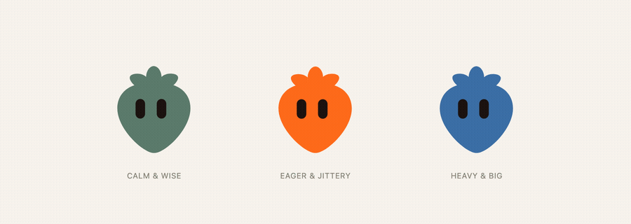

# procedural-bot-animations



A procedural animation engine for a silhouette-plus-eyes avatar — the shape format from [Open Bot Avatar](https://github.com/DominikScholz/open-bot-avatar) — with weighted/blended moods, one-shot reaction timelines (bounce, fright, nod, double-blink), gaze with saccade/pursuit/microsaccade physics and a fake-3D turn, plus a typed state machine for tying it all to real app events.

Open Bot Avatar is used only to **model** the shape (its editor or `generate-avatar` skill produce the JSON). This package never calls Open Bot Avatar's own renderer or runtime — it renders the shape itself, so moods and reactions can actually deform the eyes and body frame to frame.

```
npm install procedural-bot-animations
```

```ts
import { getExample } from "open-bot-avatar"; // optional: a source of example shapes
import { bindBrain, createStateMachine } from "procedural-bot-animations";

const host = document.querySelector("#bot")!;

const machine = createStateMachine({
  initial: "idle",
  states: {
    idle: { id: "idle" },
    thinking: { id: "thinking" },
    success: { id: "success", after: { ms: 1800, to: "idle" } },
  },
  transitions: [
    { from: "idle", event: "ask", to: "thinking" },
    { from: "thinking", event: "resolve", to: "success" },
  ],
});

const bot = bindBrain({ host, definition: getExample("mug")!, color: "#ff6a1a" });
machine.subscribe((state) => {
  if (state === "thinking") bot.brain.setMood({ focused: 1 });
  if (state === "success") { bot.brain.setMood({ proud: 1 }); bot.brain.react("bounce"); }
  if (state === "idle") bot.brain.setMood({ focused: 0, proud: 0 });
});
bot.start();

// elsewhere in your app:
machine.send("ask");
```

A full, running version of this — with buttons, a mood/reaction panel, a character picker, light/dark and reduced-motion support — is in [`examples/states-demo.html`](examples/states-demo.html).

## What's in this repo

| Path | What |
|---|---|
| [`src/`](src) | The engine: `render.ts` (mounts a definition as this package's own SVG — body path + two posable eyes), `moods.ts` (weighted/blended named moods), `reactions.ts` (one-shot keyframe-free closed-form reaction curves with a priority queue), `gaze.ts` (pursuit/saccade/microsaccade physics, autonomous wander), `fake3d.ts` (the flat-silhouette "head turn" illusion), `blink.ts`, `brain.ts` (composes all of the above into one `Pose` per frame, no DOM), `bind.ts` (the DOM/`requestAnimationFrame` glue), `state-machine.ts` (generic FSM), `scroll-traveler.ts` (a character that travels between page sections on scroll) |
| [`skills/procedural-bot-animations/`](skills/procedural-bot-animations) | A [Claude Code](https://claude.com/claude-code) skill teaching an agent to use this engine, with a calibrated motion cookbook, a state-machine design guide, and a case study |
| [`examples/`](examples) | A runnable states demo (Open Bot Avatar example shapes) and [`examples/berry-live/`](examples/berry-live) — see below |
| [`docs/architecture.md`](docs/architecture.md) | How the layers fit together, and how to point this at a different renderer |
| [`tests/`](tests) | Vitest unit tests (no DOM required — `render.ts`/`bind.ts` are the only DOM-dependent modules, verified by hand via the examples) |

## Berry: a case study, not a toy example

[`examples/berry-live/`](examples/berry-live) is a faithful, working port of [DevBerry](https://devberry.app)'s actual mascot — real body-and-leaf geometry, real spring/leaf-bend physics, real keyframed personality reactions (wink, flatten, somersault), ported line-for-line from its production engine (credit and detail in [`skills/procedural-bot-animations/references/berry-case-study.md`](skills/procedural-bot-animations/references/berry-case-study.md)). It's **not** part of the installable package — Berry has a multi-part rig (three independently-sprung leaves), a different shape than the single silhouette `src/` targets. It's here so the gap between "a generic single-silhouette engine" and "a production multi-part character" is something you can see and copy from, not just a sentence in a README.

## Relationship to Open Bot Avatar

This is an independent, unofficial companion project — not affiliated with or published by Open Bot Avatar's author. It depends on nothing from `open-bot-avatar` at runtime: the engine only needs a `{ body: { path }, eyes: { x, y, spacing, scale } }` definition, which you can get from Open Bot Avatar's editor/skill, hand-write, or generate any other way.

Open Bot Avatar is MIT-licensed by Dominik Scholz. This repo is also MIT-licensed; see [LICENSE](LICENSE). Berry is DevBerry's mascot, included in `examples/berry-live/` with its owner's permission (see the case study for exactly what's ported and what isn't).

## Development

```bash
npm install
npm run typecheck
npm test
npm run build
```

`npm run check` runs all three in sequence — the same thing CI runs on every push.

## Contributing

Issues and PRs are welcome. See [CONTRIBUTING.md](CONTRIBUTING.md).

## License

[MIT](LICENSE)
