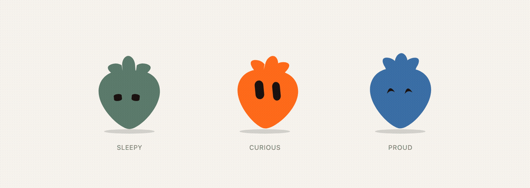

# Procedural bot animations



An engine that animates a 2D SVG character: a body outline, two eyes and up to three moving parts. It computes one pose per frame from an idle that never repeats, blended moods, looping activities and one-shot reactions, and writes it to plain SVG. Characters and animations are plain JSON.

Three jobs, each with its own reference:

| Job | Read |
|---|---|
| Mount a character and drive it from app events | This file, then [`references/state-machine-guide.md`](references/state-machine-guide.md) |
| Generate a character as JSON | [`references/generate-character.md`](references/generate-character.md) |
| Generate an animation as JSON | [`references/generate-animation.md`](references/generate-animation.md) |

Also: [`references/motion-cookbook.md`](references/motion-cookbook.md) (calibrated numbers) and [`references/built-in-characters.md`](references/built-in-characters.md) (Berry and Flame).

## Get the package

In a project: `npm install procedural-bot-animations`. In a checkout of the repo: `npm install && npm run build`, then import from `dist/index.js`. The package is ESM only. Do not install or import `open-bot-avatar`; the engine only reads the shape of its JSON.

## Workflow: mount and wire

1. **Ask only what is missing**, in one message:
   - Which character: Berry or Flame (built in), or a custom one? For a custom one, use the character reference below and do not invent a silhouette without being asked.
   - Which app events should drive it (a request in flight, a success, an error)? If unspecified, use the table below.
2. **Mount it.**

   ```ts
   import { mountCharacter, RIG_BERRY } from "procedural-bot-animations";

   const bot = mountCharacter(host, {
     rig: RIG_BERRY,        // or parseCharacter(json).value.rig
     size: 200,             // px wide; omit to fill the host
     color: "#e11d2e",
     label: "Assistant",    // gives the SVG role="img"; without it the SVG is aria-hidden
   });
   ```

3. **Wire events** with `bot.update({ mood, activity })` and `bot.react(name)`.
   - `mood` is a name or a weight map. It replaces the previous mood.
   - `activity` is a name or `null`. It loops while set.
   - `react(name)` plays once and returns `false` for an unknown name.
4. **If there are several states**, design a state machine ([`references/state-machine-guide.md`](references/state-machine-guide.md)).
5. **Clean up** with `bot.destroy()` when the host is removed.

### What exists out of the box

| Kind | Names |
|---|---|
| Moods (`MOODS`) | `neutral`, `curious`, `focused`, `suspicious`, `sleepy`, `proud`, `downcast`, `angry`, `smiling` |
| Activities (`ACTIVITIES`) | `thinking`, `loading`, `sleeping`, `flickering`, `out` |
| Reactions (`REACTIONS`) | 36. Common: `success`, `successExercise`, `successModule`, `almostThere`, `fright`, `idea`, `confused`, `dizzy`, `wink`, `cheerful`, `somersault`, `welcome`, `copiedThat`, `wake`. Transformations: `morphLoading`, `morphCheck`, `morphCode`, `energy` (these cannot be interrupted). Flame effects: `ignite`, `extinguish`, `blaze`, `crackle`, `sneeze`, `tierUp`, `warmUp`, `heatUp`, `burst` |

Run `Object.keys(REACTIONS)` for the full list. A sensible default mapping:

| App event | Call |
|---|---|
| Waiting for a response | `update({ mood: "focused", activity: "thinking" })` |
| Request in flight (a spinner) | `update({ activity: "loading" })` |
| Success | `update({ mood: "proud", activity: null })` and `react("success")` |
| Error | `update({ mood: "downcast", activity: null })` and `react("confused")` |
| Idle for a long time | `update({ mood: "sleepy" })`, or `update({ activity: "sleeping" })` |
| Something needs attention | `react("idea")` or `react("fright")` |

### Options worth knowing

| Option | Meaning |
|---|---|
| `gaze` | `"pointer"` (default), `"free"` (wanders the page), `"focus"` (looks at what matters: focused fields, typing, clicks, scroll, elements with `data-bot-focus`), a `{ x, y }` in window px, a function returning one, or `null` |
| `interactive` | `false` turns off hover and click reactions. Default `true` |
| `reducedMotion` | `"auto"` (default, follows the system), `true`, `false` |
| `eyeStyle` | `"classic"` (default), `"pumpy"` or `"big"` |
| `library` | A `Library` with custom reactions, activities and moods. See the animation reference |
| `bend` | `false` turns off the physics bend of the parts |
| `appendages` | A list of roles (`"C"`, `"L"`, `"R"`) to draw. Default: all |
| `onEvent` | Called with `{ type: "hover" | "click", name }` when a gesture is drawn |

`bot.update({...})` accepts the same options later. It rebuilds the SVG only when it must. `bot.brain` is the `Brain`, if you need `jump()` or `react(name, now)` directly.

## Workflow: generate a character

Follow [`references/generate-character.md`](references/generate-character.md). In short: write the JSON in a 0..100 box, then **validate it with `parseCharacter` through a one-off node script**, fix every error and validate again. Do not hand over a character that was not validated, unless the package could not be run, and then say so.

## Workflow: generate an animation

Follow [`references/generate-animation.md`](references/generate-animation.md). In short: pick a kind (`reaction`, `activity` or `mood`), write keyframe tracks over delta fields, **validate with `parseAnimation`**, fix every error, and read the `describeAnimation` sentence back. Play it with `createLibrary()`, `addToLibrary(library, result.value.compiled)` and `mountCharacter({ library })`.

## Quality checklist

- Reduced motion is on by default (`"auto"`). Test it with `reducedMotion: true`: only expression changes should remain.
- Pass a `color` that shows on both light and dark backgrounds, or switch it with the theme.
- Give the character a `label` when it carries meaning. Leave it out when it is decoration.
- The SVG is not focusable. Put real actions on real buttons.
- A custom character with an `id` other than `berry` or `flame` uses Berry's hover and click gestures.
- Do not add your own periodic motion on top of the gaze. See the cookbook.

## Reference material

- [`references/motion-cookbook.md`](references/motion-cookbook.md): blink, saccade, spring, hold and hover numbers, built-in mood values, reaction magnitudes.
- [`references/state-machine-guide.md`](references/state-machine-guide.md): states, transitions, timers and interrupts, wired to a mounted character.
- [`references/generate-character.md`](references/generate-character.md): the character contract and a validate-and-fix loop.
- [`references/generate-animation.md`](references/generate-animation.md): the animation contract, animation craft and a validate-and-fix loop.
- [`references/built-in-characters.md`](references/built-in-characters.md): Berry and Flame.
- Repo docs: `docs/architecture.md`, `docs/character-format.md`, `docs/animation-format.md`. The Studio is at <https://jp-mainieri.github.io/procedural-bot-animations/>.

## Install for other sessions

Link rather than copy so the skill stays in sync with the repo:

```bash
ln -s "$PWD/skills/procedural-bot-animations" ~/.claude/skills/procedural-bot-animations
```
