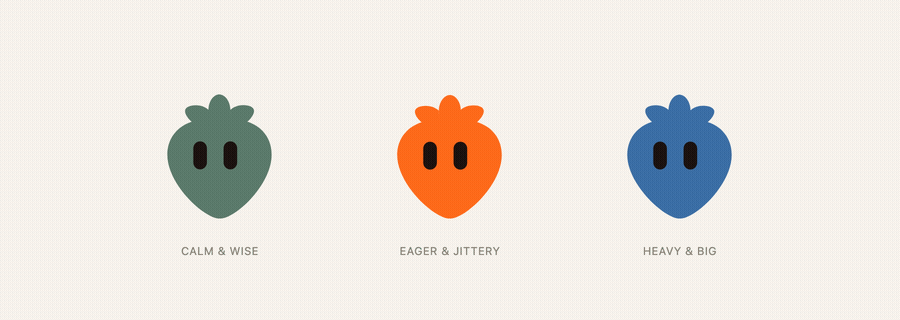

# Procedural bot animations



A silhouette-plus-eyes definition (`{ body: { path }, eyes: { x, y, spacing, scale } }` — Open Bot Avatar's JSON format) is just data: a shape with nowhere to put a mood, a reaction, or a gaze. This skill is the engine that reads that data, renders it as its own SVG (so moods and reactions can actually deform the eyes and body), and drives it over time from real app events.

Two layers, used together, and only the first comes from Open Bot Avatar:

1. **The shape** — model it in [the editor](https://dominikscholz.github.io/open-bot-avatar/), with its `generate-avatar` skill, or by hand against [its contract](https://github.com/DominikScholz/open-bot-avatar/blob/main/docs/avatar-contract.md). This skill does not design silhouettes, and never imports `open-bot-avatar`'s own renderer (`mountAvatar`, `update()`) — only its JSON shape.
2. **The life** — this skill's engine (`src/`): render the shape yourself, blend moods, play reactions, drive gaze, and tie a state machine's events to all three.

## Workflow

1. **Confirm what exists already.** Ask only what's missing, in one message:
   - Is there a definition yet? If not, point at Open Bot Avatar's editor or `generate-avatar` skill — don't invent a silhouette here.
   - Does the character have separate moving parts (limbs, ears, a tail)? If so, say so up front: this engine's `src/` only handles a single silhouette. Read `references/berry-case-study.md` and follow its pattern (per-part base spring + tip spring + path-bend) instead of forcing a multi-part character through `src/`.
   - What app events should drive state (e.g. "loading" while a request is in flight, "success"/"error" on its result)? If unspecified, default to the common set below.
2. **Render it** with `mountRig` (`src/render.ts`) — mounts the definition as the engine's own SVG (one body path, two independently-posable eye groups), not Open Bot Avatar's renderer.
3. **Design the state machine** using `createStateMachine` (`src/state-machine.ts`) — see `references/state-machine-guide.md` for common states, timers and interrupt rules.
4. **Wire the engine** with `bindBrain` (`src/bind.ts`), which every frame runs a `Brain` (`src/brain.ts`: mood blending + gaze + fake-3D turn + blink + breathing + the active reaction) and applies the resulting `Pose` to the rig. In each state's handler, call `brain.setMood({...})` and/or `brain.react("bounce")`. Calibrated values and recipes: `references/motion-cookbook.md`.
5. **Scroll-traveling bot?** Use `travelerFrame`/`findActiveSlot` from `src/scroll-traveler.ts`. DOM-free; you read `.slot` elements' rects yourself and hand it numbers.
6. **Demo as a working page.** `examples/states-demo.html` is a complete, runnable reference (character picker, mood toggles, reaction buttons, a log, light/dark, `prefers-reduced-motion`). Reuse its structure rather than starting from a blank page.

## Common bot states

`idle`, `thinking`, `success`, `error`, `loading`, `sleeping` cover most apps. Add custom ones freely — `createStateMachine` is generic over any string union. Rules of thumb:
- `error` should be hard to interrupt accidentally (`interruptibleBy: ["idle"]`) so a user action doesn't visually cancel an error before they've read it.
- `success`/short acknowledgement states should auto-return to `idle` via `after: { ms, to: "idle" }`, not wait for an explicit event.
- Map a state to a mood weight map (`brain.setMood({...})`) plus, where it's a one-off like "success", a reaction (`brain.react("bounce")`) — moods persist while the state is active, reactions play once.

## Quality checklist

- `prefers-reduced-motion`: stop idle wander, breathing and blinking; keep only the discrete mood/pose change.
- Works in light and dark (pass an explicit `color`; don't hardcode one that disappears on either background).
- Frame deltas are already capped inside `bindBrain` (`safeDt`) so a backgrounded tab doesn't make springs explode on return.
- No dependency beyond this package for rendering — `open-bot-avatar` (optional) is only a source of JSON shapes, never a runtime dependency of `src/`.

## Reference material

- `references/motion-cookbook.md` — calibrated values (breathing rate, gaze damp rate, wander timing, mood/reaction parameters) and personality-to-parameter tuning.
- `references/state-machine-guide.md` — how to design states/transitions/timers/interrupts for a bot, with worked examples.
- `references/berry-case-study.md` — **read this before animating any character with separate moving parts.** A faithful, working port of DevBerry's actual mascot (`examples/berry-live/`), showing what a multi-part rig needs that this engine's single-silhouette `src/` doesn't attempt.
- `examples/states-demo.html` — interactive demo of the generic engine (Open Bot Avatar example shapes).
- `examples/berry-live/berry-demo.html` — interactive demo of the Berry port.
- [Open Bot Avatar docs](https://dominikscholz.github.io/open-bot-avatar/#/docs) and [avatar contract](https://github.com/DominikScholz/open-bot-avatar/blob/main/docs/avatar-contract.md) — the shape side, referenced but not duplicated here.

## Install for other sessions

Link rather than copy so the skill stays in sync with the repo:

```bash
ln -s "$PWD/skills/procedural-bot-animations" ~/.claude/skills/procedural-bot-animations
```
